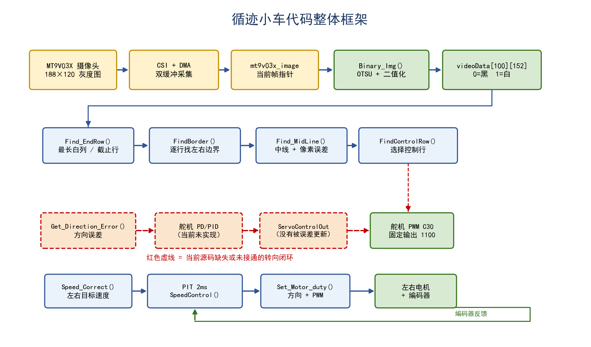
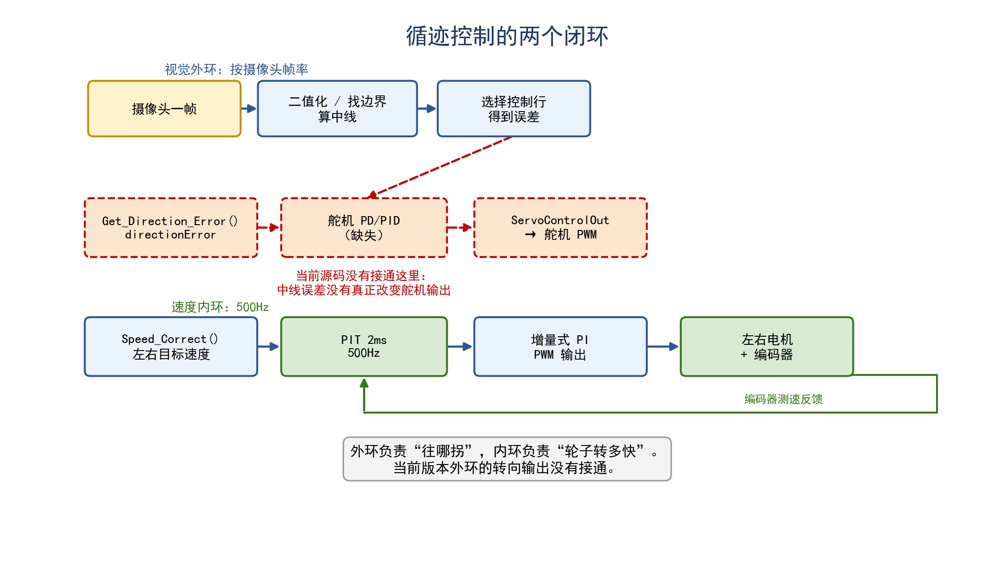
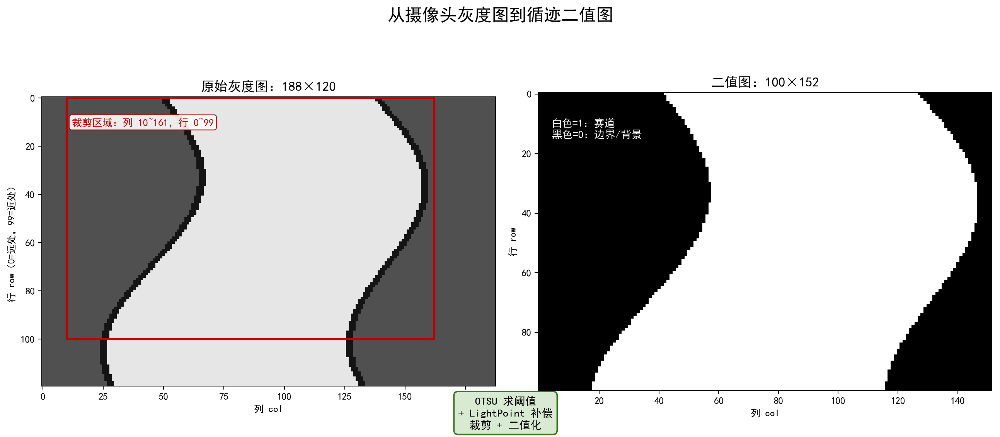
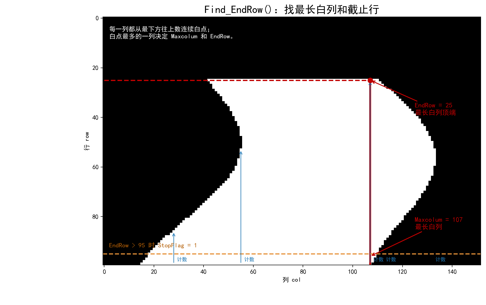
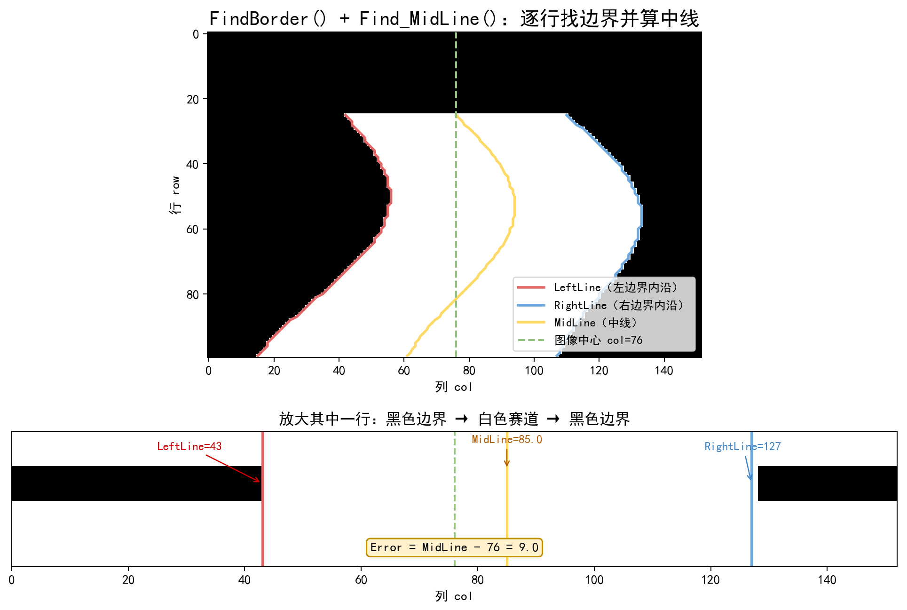
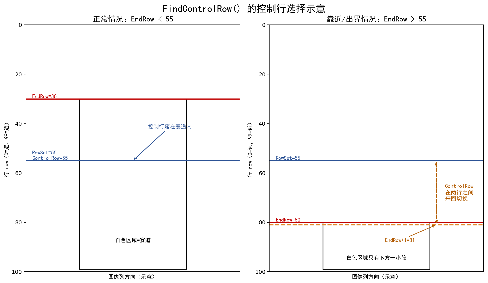

# 循迹小车代码详解（小白版）

> 文档位置：`C:\Users\76188\Desktop\SmartCar_demo\SmartCar_demo\docs\循迹小车代码详解.md`  
> 代码根目录：`C:\Users\76188\Desktop\SmartCar_demo\SmartCar_demo`  
> 适用提交：`5dd2b84 初始提交：RT1064 智能车完整工程`  
> 说明：本文基于当前工作区源码整理。代码改动后，函数行号可能发生变化。

---

## 0. 先看结论

这是一辆**摄像头循迹小车**，不是灰度传感器循迹，也不是电磁循迹。

它的基本思路可以概括为一句话：

> 摄像头先“看见”白色赛道和黑色边界，程序把图像变成黑白图，再找出赛道左右边界和中心线；根据中心线相对图像中心的偏差决定舵机往哪边打，同时用编码器闭环控制左右轮速度。

完整数据流如下：

```text
MT9V03X 摄像头
    -> CSI + DMA 采集灰度图
    -> OTSU 自动阈值 + 二值化
    -> videoData[100][152] 黑白图
    -> Find_EndRow() 找最长白列和截止行
    -> FindBorder() 找左右边界
    -> Find_MidLine() 算中线和像素误差
    -> FindControlRow() 选控制行
    -> 方向误差 -> 舵机转向
    -> Speed_Correct() -> 2ms 速度闭环 -> 左右电机
```

先记住两个重要结论：

1. **图像处理链路基本完整**：能二值化、找边界、算中线、选控制行。
2. **舵机转向链路没有真正接通**：当前源码没有把中线误差转换成舵机输出，所以按当前代码直接运行，车辆不能正常闭环循迹。

后面会详细解释每一步。

---

## 1. 项目基本信息

### 1.1 实际仓库位置

工作区根目录是：

```text
C:\Users\76188\Desktop\SmartCar_demo
```

但真正的 Git 仓库在下一层：

```text
C:\Users\76188\Desktop\SmartCar_demo\SmartCar_demo
```

当前 Git 状态：

```text
分支：main
提交：5dd2b84 初始提交：RT1064 智能车完整工程
工作区：干净
```

同目录还有一个 `_git_backup` 文件夹，里面是备份的裸仓库。它不是当前工程的一部分，但里面有更完整的旧版本代码，后面会简单提到。

### 1.2 技术栈

| 项目 | 内容 |
|---|---|
| 主控 | NXP i.MX RT1064，Cortex-M7，主频 600MHz |
| 开发语言 | C |
| 运行方式 | 裸机，无 RTOS |
| 摄像头 | MT9V03X 灰度摄像头，原始分辨率 188×120 |
| 摄像头接口 | CSI + DMA，双缓冲 |
| 舵机 | PWM4_MODULE2_CHA_C30 |
| 电机 | 左电机 PWM D0 / DIR D1，右电机 PWM D3 / DIR D2 |
| 编码器 | QTIMER1_ENCODER1：C0/C1；QTIMER1_ENCODER2：C2/C24 |
| 显示屏 | OLED，用于显示二值图 |
| 构建方式 | IAR 8.32.4 或 MDK 5.33 |
| 自动化测试 | 无 |

### 1.3 构建入口

- IAR 工程：`project/iar/rt1064.eww` 或 `project/iar/program/rt1064.ewp`
- MDK 工程：`project/mdk/rt1064.uvprojx`
- VS Code 配置：`project/.vscode/c_cpp_properties.json`，主要用于代码提示

注意：当前 MDK 工程只挂载了 `main.c` 和 `isr.c`，没有挂载 `project/code/*.c`。按当前清单直接用 MDK 编译，链接阶段会出现自定义函数的未定义符号。IAR 工程中已经包含这些算法文件。

---

## 2. 用生活化比喻理解循迹

可以把小车想象成一个人在路上开车：

| 程序部分 | 生活化比喻 |
|---|---|
| 摄像头 | 眼睛 |
| 二值化 | 把彩色世界简化成黑白地图 |
| `FindBorder()` | 找路的左右边缘 |
| `Find_MidLine()` | 找路的中心线 |
| `FindControlRow()` | 眼睛看前方某一行，而不是只看脚下 |
| `directionError` | “我现在偏左还是偏右” |
| 舵机 | 方向盘 |
| 编码器 + 速度闭环 | 定速巡航 |
| 电机 PWM | 油门大小 |

整个过程不是一步完成的，而是：

```text
先看路 -> 再找路边 -> 再算路中心 -> 再判断偏了多少 -> 再打方向 -> 同时控制轮速
```

---

## 3. 整体代码框架



*图 1：循迹小车代码整体框架。红色虚线表示当前源码缺失或没有接通的转向闭环。*

### 3.1 初始化

入口函数是 `project/user/src/main.c` 中的 `main()`。

初始化顺序：

```c
clock_init(SYSTEM_CLOCK_600M);
system_delay_ms(500);
oled_init();
mt9v03x_init();
mt9v03x_set_exposure_time(370);
Servo_PWM_Init();
Motor_PWM_Init();
Encoder_Init();
pit_ms_init(PIT_CH0, 2);
system_delay_ms(500);
interrupt_global_enable(0);
```

对应 `main.c:55-82`。

各步骤含义：

| 初始化 | 作用 |
|---|---|
| `clock_init(600M)` | 设置系统时钟，不能删除 |
| `oled_init()` | 初始化 OLED，用于显示二值图 |
| `mt9v03x_init()` | 初始化 MT9V03X 摄像头和 CSI/DMA |
| `mt9v03x_set_exposure_time(370)` | 设置摄像头曝光时间 |
| `Servo_PWM_Init()` | 初始化舵机 PWM |
| `Motor_PWM_Init()` | 初始化左右电机 PWM 和方向引脚 |
| `Encoder_Init()` | 初始化正交编码器 |
| `pit_ms_init(PIT_CH0, 2)` | 配置 2ms 定时中断，用于速度闭环 |
| `interrupt_global_enable(0)` | 打开全局中断 |

### 3.2 主循环

主循环在 `main.c:84-109`：

```c
while (1)
{
    if (mt9v03x_finish_flag)
    {
        mt9v03x_finish_flag = 0;

        Binary_Img();
        OLED_Print_Img128X64(videoData);

        Find_EndRow();
        RealEndRow = EndRow;
        CorrectEndRow();

        FindBorder();
        Find_MidLine();
        FindControlRow();

        Direction_Control_Error();
        Speed_Correct();
    }
}
```

可以把它理解成：

```text
等一帧图像完成
  -> 二值化
  -> 显示（调试用）
  -> 找最长白列/截止行
  -> 找左右边界
  -> 算中线
  -> 选控制行
  -> 更新舵机输出
  -> 更新左右轮目标速度
```

### 3.3 两个闭环



*图 2：视觉外环和速度内环。当前版本的视觉外环能算误差，但没有把误差接到舵机输出。*

这个系统实际上有两个控制频率：

#### 视觉外环

运行在 `main()` 的 `while(1)` 中，频率跟随摄像头帧率。

负责：

- 看图像
- 找边界
- 算中线
- 选控制行
- 计算方向误差
- 给出左右轮目标速度

#### 速度内环

运行在 `PIT_CH0` 的 2ms 中断中，频率是：

```text
1 / 0.002s = 500Hz
```

负责：

- 读编码器
- 计算实际速度
- 用 PI 控制计算 PWM
- 设置左右电机占空比

对应 `project/user/src/isr.c` 中的 `PIT_IRQHandler()`：

```c
if (pit_flag_get(PIT_CH0))
{
    pit_flag_clear(PIT_CH0);
    SpeedControl();
}
```

一句话总结：

> 外环负责“往哪拐”，内环负责“轮子转多快”。

---

## 4. 循迹全过程逐步讲解

### 4.1 第一步：摄像头采图

MT9V03X 的原始图像是：

```text
宽 188，高 120，灰度图
```

摄像头驱动使用 CSI + DMA 采集，并准备了两块图像缓冲区：

```c
uint8 mt9v03x_image1[120][188];
uint8 mt9v03x_image2[120][188];
uint8 (*mt9v03x_image)[188];
```

采集完成一帧后，驱动在回调函数中做两件事：

1. 把 `mt9v03x_image` 指向刚采集完成的缓冲区。
2. 把 `mt9v03x_finish_flag` 置 1。

主循环检测到 `mt9v03x_finish_flag` 后，先清零，再处理这一帧。

这种“一个缓冲区正在采集，另一个缓冲区给程序处理”的方式叫**双缓冲**。它可以避免程序处理图像时，摄像头把图像改掉。

### 4.2 第二步：裁剪和二值化



*图 3：原始灰度图裁剪成 100×152 的二值图。示意图中的赛道是程序生成的，只用于解释算法。*

关键函数：

```c
void Binary_Img(void);
uint8 Fast_OTSU(uint8 *img, int16 row, int16 col);
```

对应文件：

```text
project/code/Camera.c
project/code/Camera.h
```

#### 为什么需要二值化？

摄像头看到的是 0~255 的灰度图。程序如果直接处理 256 个灰度级，计算量大，也不容易判断“哪里是赛道、哪里是边界”。

二值化就是把图像变成两种颜色：

```text
黑色 = 0
白色 = 1
```

当前代码的假设是：

- **白色区域是赛道**
- **黑色区域是边界或背景**

如果实际赛道颜色相反，这段代码就会识别错误。

#### 阈值是怎么来的？

默认 `staticBinary = 0`，所以使用动态阈值：

```c
dynamicBinary = Fast_OTSU(mt9v03x_image[0], MT9V03X_H, MT9V03X_W) + LightPoint;
```

其中：

- `Fast_OTSU()` 用大津法自动计算一个分割阈值。
- `LightPoint = 20` 是额外补偿。
- 如果 `staticBinary` 改成非零值，就直接使用固定阈值。

大津法的核心思想是：

> 找到一个灰度值，让“黑色部分”和“白色部分”之间的差异尽可能大。

#### 图像裁剪

原始图像是 188×120，但程序只使用其中一部分：

```c
videoData[100][152]
```

对应原始图像：

```text
行：0 ~ 99
列：10 ~ 161
```

代码里：

```c
#define ROW 100
#define COL 152
#define COL_DIS 28
int trans = 4;
```

列起点是：

```c
COL_DIS / 2 - trans = 14 - 4 = 10
```

也就是左边裁掉 10 列，右边裁掉 26 列。行方向保留上方 100 行，去掉下方 20 行。

#### 二值化结果

```c
videoData[row][col] = (mt9v03x_image[row][col] < dynamicBinary) ? BLACK : WHITE;
```

含义：

- 灰度值小于阈值：黑色，记 0。
- 灰度值大于等于阈值：白色，记 1。

### 4.3 第三步：找最长白列和截止行



*图 4：每一列从下往上数连续白点，白点最多的一列决定 `Maxcolum` 和 `EndRow`。*

关键函数：

```c
void Find_EndRow(void);
void CorrectEndRow(void);
```

对应文件：

```text
project/code/FindEndrow.c
project/code/FindEndrow.h
```

`Find_EndRow()` 的逻辑：

```text
对每一列 col：
    从图像最下方 row=99 开始向上扫描
    如果当前像素是白色，计数加 1
    如果遇到黑色，停止
    记录这一列的连续白点数量 num

如果 num 比当前最大值还大：
    EndRow = 停止处的行号
    Maxcolum = 这一列的列号
```

可以得到两个变量：

| 变量 | 含义 |
|---|---|
| `EndRow` | 最长白列中最上方白点所在的行，可以理解为赛道可见的最远位置 |
| `Maxcolum` | 最长白列对应的列号，后续找边界时从这里开始 |

代码还会限制 `Maxcolum` 的范围：

```c
if (Maxcolum >= COL - 3) Maxcolum = COL - 3;
if (Maxcolum <= 2)      Maxcolum = 2;
```

这是为了给左右边界扫描留出空间。

#### 出界停车

```c
if (EndRow > 95) StopFlag = 1;
```

当最长白列的顶端已经接近图像底部，说明赛道基本消失，可能是出界或到达终点。

注意：`StopFlag` 当前没有复位逻辑。一旦置 1，车辆会一直保持停车状态，直到复位单片机。

#### 截止行修正

```c
void CorrectEndRow(void)
{
    if (EndRow < 2)
    {
        EndRow = 2;
    }
}
```

目的是防止 `EndRow` 太小导致后续扫描越界。

### 4.4 第四步：逐行找左右边界



*图 5：上图是每一行找边界后得到的左边界、右边界和中线；下图放大其中一行，解释 `LeftLine`、`RightLine`、`MidLine` 和 `Error`。*

关键函数：

```c
void FindBorder(void);
```

对应文件：

```text
project/code/FindBorder.c
project/code/FindBorder.h
```

`FindBorder()` 从图像最下方一行开始，逐行向上扫描。

对每一行：

1. 从 `Maxcolum` 开始向左找。
2. 如果连续 3 个像素都是黑色，就认为碰到左边界。
3. 记录 `LeftLine[row]`。
4. 再从 `Maxcolum` 开始向右找。
5. 如果连续 3 个像素都是黑色，就认为碰到右边界。
6. 记录 `RightLine[row]`。

用连续 3 个黑点判断，是为了过滤单个噪声点。

示意图里：

```text
黑色边界 -> 白色赛道 -> 黑色边界
```

程序找到的是白色赛道两侧的内沿，而不是黑色线本身的中心。

#### `FindBorder1()` 是什么？

`FindBorder.c` 里还有一个 `FindBorder1()`，它使用“上一行边界位置”来搜索当前行，连续性更好。

但当前主循环只调用了 `FindBorder()`，**没有调用 `FindBorder1()`**。因此：

- `LeftLine1[]`、`RightLine1[]` 没有被使用。
- `ValidRow` 也没有被更新，始终是初始值 0。
- `FindBorder()` 实际会扫描完整的 100 行。

### 4.5 第五步：计算赛道中线

关键函数：

```c
void Find_MidLine(void);
```

对应文件：

```text
project/code/FindMidline.c
project/code/FindMidline.h
```

核心公式：

```c
MidLine[i] = (LeftLine[i] + RightLine[i]) / 2;
Error[i]   = MidLine[i] - COL / 2;
```

其中：

```text
COL / 2 = 152 / 2 = 76
```

- `MidLine[i]`：这一行的赛道中心。
- `Error[i]`：赛道中心相对图像中心的像素偏差。

正负号含义：

| 情况 | `Error[i]` |
|---|---|
| 赛道中心在图像右侧 | 正数 |
| 赛道中心在图像左侧 | 负数 |
| 赛道中心正好在中间 | 0 |

代码还保存了：

```c
Original_MidLine[i]
Original_Error[i]
```

用于以后做元素识别或误差修正，但当前没有被其他模块使用。

### 4.6 第六步：选择控制行



*图 6：控制行选择的两种情况。右侧展示了 `EndRow > 55` 时可能出现的控制行来回切换。*

关键函数：

```c
void FindControlRow(void);
```

对应文件：

```text
project/code/FindControlRow.c
project/code/FindControlRow.h
```

当前代码：

```c
if (ControlRow < EndRow)
    ControlRow = EndRow + 1;
else
    ControlRow = RowSet;
```

默认参数：

```c
int RowSet = 55;
int ControlRow = 50;
```

设计意图：

- 正常情况下，用第 55 行附近的中线误差控制舵机。
- 如果赛道截止行比控制行更靠下，就把控制行移到 `EndRow + 1`，避免使用赛道已经消失的区域。

但当前写法有一个问题：当 `EndRow > 55` 时，`ControlRow` 可能在 `55` 和 `EndRow + 1` 之间来回切换。

例如：

```text
第一帧：ControlRow=55，EndRow=80
        55 < 80，ControlRow 变成 81

第二帧：ControlRow=81，EndRow=80
        81 < 80 不成立，ControlRow 回到 55

第三帧：又变成 81
```

这会造成控制行跳动。当前转向输出没有接通，所以这个问题暂时没有直接表现；如果之后补全舵机控制，需要一起修正。

### 4.7 第七步：计算方向误差

关键函数：

```c
void Get_Direction_Error(void);
```

对应文件：

```text
project/code/Servo.c
project/code/Servo.h
```

代码：

```c
directionError = ((float)(MidLine[ControlRow] - (COL / 2))) / COL;
directionError *= -3.0;
directionError = LimitBoth_float(directionError, -1.0, 1.0);
```

逐句解释：

1. `MidLine[ControlRow] - COL / 2`：控制行中线相对图像中心的像素偏差。
2. 除以 `COL`：归一化。
3. 乘以 `-3.0`：放大误差并改变方向。
4. 限幅到 `[-1, 1]`：防止误差过大。

但是，**当前主循环没有调用 `Get_Direction_Error()`**。

搜索整个应用层代码，只能找到函数定义和声明，没有调用点。因此 `directionError` 一直保持初始值 0。

### 4.8 第八步：舵机控制

#### 舵机初始化

```c
pwm_init(SERVO_PWM, 75, ServoMid);
```

参数：

```c
#define SERVO_PWM PWM4_MODULE2_CHA_C30
int ServoMid = 1220;
int ServoRMax = 120;
int ServoLMax = 120;
```

- PWM 频率：75Hz
- 中位占空比：1220
- 输出范围：1100 ~ 1340

#### 当前实际执行的舵机代码

主循环调用的是：

```c
void Direction_Control_Error(void)
{
    ServoControlOut = LimitBoth_int(
        ServoControlOut,
        ServoMid - ServoRMax,
        ServoMid + ServoLMax
    );

    if (StopFlag)
        pwm_set_duty(SERVO_PWM, ServoMid);
    else
        pwm_set_duty(SERVO_PWM, ServoControlOut);
}
```

它只做了两件事：

1. 把 `ServoControlOut` 限制在 1100 ~ 1340。
2. 把 `ServoControlOut` 写入 PWM。

问题是：`ServoControlOut` 初始值是 0，代码里没有地方根据 `directionError` 修改它。

第一次调用时：

```text
LimitBoth_int(0, 1100, 1340) = 1100
```

之后 `ServoControlOut` 一直是 1100。

因此当前实际效果是：

```text
舵机固定输出 1100
车辆不会根据中线误差打方向
```

如果 `StopFlag` 为 1，舵机会回到中位 1220。

#### 哪些变量没有用上？

```c
int direction_Kp = 80;
int direction_Kd = 80;
int direction_Ki = 10;
float directionError = 0;
static float error1, error2;
```

这些变量看起来是为舵机 PD/PID 准备的，但当前都没有参与计算。

另外，`Servo.h` 中声明了：

```c
void Direction_Control();
```

但 `Servo.c` 中没有实现这个函数。当前也没有调用它，否则会链接报错。

### 4.9 第九步：速度闭环

对应文件：

```text
project/code/SpeedControl.c
project/code/SpeedControl.h
project/user/src/isr.c
```

#### 硬件映射

```c
#define LeftDIR   D1
#define LeftPWM   PWM1_MODULE3_CHA_D0
#define RightDIR  D2
#define RightPWM  PWM2_MODULE3_CHB_D3
#define MOTOR_FREQUENCE 17000
```

- 电机 PWM 频率：17kHz
- 左电机：PWM D0，方向 D1
- 右电机：PWM D3，方向 D2

#### 编码器测速

```c
leftPulse  = -encoder_get_count(QTIMER1_ENCODER1);
rightPulse =  encoder_get_count(QTIMER1_ENCODER2);
```

然后计算速度：

```c
leftSpeed  = (leftPulse  * 100) / (LEFT_PULSE_PER_METER  * dt);
rightSpeed = (rightPulse * 100) / (RIGHT_PULSE_PER_METER * dt);
```

参数：

```c
#define dt 0.002
#define LEFT_PULSE_PER_METER  12000
#define RIGHT_PULSE_PER_METER 12000
```

按当前标定，速度单位约为 `0.01 m/s`：

```text
expSpeed = 100  -> 约 1 m/s
expSpeed = 200  -> 约 2 m/s
```

#### 目标速度

```c
void Speed_Correct(void)
{
    expSpeedL = expSpeed + LKliff;
    expSpeedR = expSpeed + RKliff;

    if (StopFlag)
    {
        expSpeedL = 0;
        expSpeedR = 0;
    }
}
```

`LKliff` 和 `RKliff` 是左右轮差速量。

但当前它们都是 0，代码中也没有任何地方修改它们。所以当前左右轮目标速度始终相同，没有差速转向。

#### 增量式 PI 控制

`SpeedControl()` 在 2ms 中断中运行：

```text
误差 = 目标速度 - 实际速度
PWM 增量 = P * (本次误差 - 上次误差)
         + I * 本次误差
         + D * (本次误差 - 2*上次误差 + 上上次误差)
```

当前参数：

```c
int speedP = 2700;   // 实际使用 27.0
int speedI = 520;    // 实际使用 5.2
int speedD = 0;
```

当前实际是 PI 控制，因为 `speedD = 0`。

最终输出：

```c
Duty_left  = speedDuty_left  * 2.0 / 3.0;
Duty_right = speedDuty_right * 2.0 / 3.0;
Set_Motor_duty(Duty_left, Duty_right);
```

最大 PWM 限制：

```text
MaxPWM = 10000
最终最大输出 = 10000 * 2/3 = 6666
```

#### 一个潜在的 D 项问题

代码里：

```c
double SPEED_CONTROL_D = speedD / 100.0;
```

但公式里实际使用的是原始 `speedD`：

```c
speedDuty_left += ... + speedD * (...);
```

当前 `speedD = 0`，所以没有影响。以后如果把 `speedD` 调成非零值，D 项会比预期大 100 倍，需要修正。

### 4.10 第十步：停车逻辑

当前停车逻辑有三层：

1. `Find_EndRow()` 中：

```c
if (EndRow > 95) StopFlag = 1;
```

2. `Speed_Correct()` 中：

```c
if (StopFlag)
{
    expSpeedL = 0;
    expSpeedR = 0;
}
```

3. `Direction_Control_Error()` 中：

```c
if (StopFlag)
    pwm_set_duty(SERVO_PWM, ServoMid);
```

效果：

- 目标速度变为 0。
- 舵机回到中位。
- `StopFlag` 不会自动复位。

---

## 5. 关键文件与函数一览

以下路径相对于代码根目录：

```text
C:\Users\76188\Desktop\SmartCar_demo\SmartCar_demo
```

| 文件 | 关键函数 | 作用 |
|---|---|---|
| `project/user/src/main.c` | `main()` | 初始化外设，轮询摄像头帧，执行视觉循迹主流程 |
| `project/user/src/isr.c` | `CSI_IRQHandler()`、`PIT_IRQHandler()` | 摄像头 CSI 中断入口、2ms 速度控制中断 |
| `project/user/inc/isr.h` | `extern uint32 ms;` | 中断相关声明 |
| `project/code/Camera.c` | `Binary_Img()`、`Fast_OTSU()`、`OLED_Print_Img128X64()` | 图像二值化、阈值计算、OLED 图像显示 |
| `project/code/FindEndrow.c` | `Find_EndRow()`、`CorrectEndRow()` | 找最长白列、截止行、出界停车标志 |
| `project/code/FindBorder.c` | `FindBorder()`、`FindBorder1()` | 逐行找左右边界；当前只用 `FindBorder()` |
| `project/code/FindMidline.c` | `Find_MidLine()` | 用左右边界平均值计算中线，并生成像素误差 |
| `project/code/FindControlRow.c` | `FindControlRow()` | 选择用于转向计算的控制行 |
| `project/code/Servo.c` | `Servo_PWM_Init()`、`Get_Direction_Error()`、`Direction_Control_Error()` | 舵机初始化和转向输出；当前转向闭环不完整 |
| `project/code/SpeedControl.c` | `Motor_PWM_Init()`、`Encoder_Init()`、`GetSpeed()`、`Speed_Correct()`、`SpeedControl()`、`Set_Motor_duty()` | 电机 PWM、编码器测速、速度闭环、差速目标计算 |
| `project/code/CommonFunction.c` | `LimitBoth_float()`、`LimitBoth_int()` | 浮点/整数限幅工具 |
| `libraries/zf_device/zf_device_mt9v03x.c` | `mt9v03x_init()`、`mt9v03x_finished_callback()` | MT9V03X 驱动、CSI/DMA 双缓冲、采集完成标志 |
| `libraries/zf_common/zf_common_headfile.h` | 无 | 汇总包含所有驱动、设备、用户头文件 |

### 5.1 最值得先读的函数

如果你是小白，建议先读这 6 个：

1. `main()`：知道整个程序怎么跑起来。
2. `Binary_Img()`：知道图像怎么变成黑白。
3. `Find_EndRow()`：知道 `EndRow` 和 `Maxcolum` 怎么来。
4. `FindBorder()`：知道左右边界怎么找。
5. `Find_MidLine()`：知道中线误差怎么算。
6. `Speed_Correct()` 和 `SpeedControl()`：知道目标速度和实际 PWM 怎么闭环。

---

## 6. 关键变量和参数

### 6.1 图像相关

| 变量 | 含义 |
|---|---|
| `videoData[100][152]` | 二值图，0=黑，1=白 |
| `dynamicBinary` | 动态二值化阈值 |
| `staticBinary` | 固定阈值，默认 0 表示不用 |
| `LightPoint` | 阈值补偿，默认 20 |
| `trans` | 图像水平裁剪偏移，默认 4 |

### 6.2 赛道相关

| 变量 | 含义 |
|---|---|
| `Maxcolum` | 最长白列对应的列号 |
| `EndRow` | 最长白列顶端所在行 |
| `RealEndRow` | 修正前的截止行 |
| `CorrectedEndRow` | 当前代码中基本未使用 |
| `LeftLine[100]` | 每行左边界内沿 |
| `RightLine[100]` | 每行右边界内沿 |
| `MidLine[100]` | 每行赛道中心 |
| `Error[100]` | 每行中线相对图像中心的误差 |
| `RowSet` | 默认控制行，55 |
| `ControlRow` | 当前实际控制行 |
| `StopFlag` | 停车标志 |

### 6.3 舵机相关

| 变量 | 含义 |
|---|---|
| `ServoMid` | 舵机中位，1220 |
| `ServoRMax` | 右侧最大偏移，120 |
| `ServoLMax` | 左侧最大偏移，120 |
| `ServoControlOut` | 舵机实际输出 |
| `directionError` | 归一化方向误差 |
| `direction_Kp/Kd/Ki` | 舵机控制参数，当前未使用 |

### 6.4 速度相关

| 变量 | 含义 |
|---|---|
| `expSpeed` | 基础目标速度，默认 100 |
| `expSpeedL/expSpeedR` | 左右轮目标速度 |
| `LKliff/RKliff` | 左右轮差速量，当前为 0 |
| `leftSpeed/rightSpeed` | 编码器测得的实际速度 |
| `speedDuty_left/right` | 速度环累计 PWM |
| `speedP/speedI/speedD` | 速度环参数 |
| `MaxPWM` | PWM 上限，10000 |

### 6.5 参数速查表

| 参数 | 当前值 | 作用 | 调整时注意 |
|---|---:|---|---|
| `ROW` | 100 | 二值图高度 | 改动会影响所有数组 |
| `COL` | 152 | 二值图宽度 | 改动会影响中线中心 76 |
| `LightPoint` | 20 | 阈值补偿 | 图像偏暗/偏亮时调整 |
| `staticBinary` | 0 | 0=动态阈值 | 非 0 时使用固定阈值 |
| `trans` | 4 | 水平裁剪偏移 | 摄像头安装偏移时调整 |
| `RowSet` | 55 | 默认控制行 | 越大看得越近，越小看得越远 |
| `ServoMid` | 1220 | 舵机中位 | 必须实测机械中位 |
| `ServoRMax/ServoLMax` | 120 | 舵机最大偏移 | 防止舵机堵转 |
| `expSpeed` | 100 | 目标速度 | 约 1m/s |
| `dt` | 0.002 | 速度环周期 | 与 PIT 配置一致 |
| `speedP` | 2700 | 速度环 P | 实际使用 27.0 |
| `speedI` | 520 | 速度环 I | 实际使用 5.2 |
| `speedD` | 0 | 速度环 D | 当前未启用 |
| `MaxPWM` | 10000 | PWM 上限 | 最终还会乘 2/3 |

---

## 7. 当前代码的主要问题

### 7.1 最重要的问题：舵机转向没有接通

当前实际路径：

```text
Find_MidLine()
  -> 得到 MidLine[] 和 Error[]

FindControlRow()
  -> 得到 ControlRow

Direction_Control_Error()
  -> 只限制 ServoControlOut
  -> 直接输出 PWM
```

缺少的路径：

```text
Get_Direction_Error()
  -> directionError
  -> 舵机 PD/PID
  -> 修改 ServoControlOut
```

按当前代码：

- `directionError` 一直是 0。
- `direction_Kp/Kd/Ki` 没有参与计算。
- `ServoControlOut` 第一次被限幅到 1100，之后一直不变。
- 舵机固定在一个略偏左的位置。

所以整车表现为：

```text
能看线，但不能根据线打方向
```

### 7.2 没有差速转向

`Speed_Correct()` 中：

```c
expSpeedL = expSpeed + LKliff;
expSpeedR = expSpeed + RKliff;
```

看起来是准备做左右轮差速，但 `LKliff` 和 `RKliff` 从未被赋值，始终为 0。

所以即使舵机转向修好，当前也没有“弯道内侧减速、外侧加速”的差速控制。

### 7.3 控制行可能抖动

`FindControlRow()` 在 `EndRow > 55` 时可能在 `55` 和 `EndRow + 1` 之间来回切换。

当前转向未接通，所以暂时没有表现；补全舵机控制后需要一起修正。

### 7.4 部分算法和变量没有接入主流程

当前未使用或基本未使用的包括：

- `FindBorder1()`
- `LeftLine1[]`、`RightLine1[]`
- `ValidRow`
- `Original_LeftLine[]`、`Original_RightLine[]`
- `Original_MidLine[]`、`Original_Error[]`
- `Get_Direction_Error()`
- `Direction_Control()`
- `direction_Kp`、`direction_Kd`、`direction_Ki`
- `LKliff`、`RKliff`
- `CorrectedEndRow`

这说明这份代码是经过裁剪或尚未完成的基础版本。

### 7.5 注释中提到的斑马线、环岛识别没有实现

`main.c` 注释写了“低速下的循迹、斑马线识别、环岛识别”，但当前 `project/code` 中没有对应的元素识别、环岛判断、速度规划代码。

当前实际只有基础循迹管线。

同目录的 `_git_backup\code.git` 里存在一个更完整的旧版本，包含 `JudgeRound.c`、`SpeedPlan.c`、`JudgeStartLine.c` 等文件，但它不是当前工作树的一部分，也没有被当前工程引用。

### 7.6 MDK 工程缺少自定义源文件

`project/mdk/rt1064.uvprojx` 中只看到：

```text
main.c
isr.c
```

没有看到：

```text
Camera.c
FindBorder.c
FindEndrow.c
FindMidline.c
FindControlRow.c
Servo.c
SpeedControl.c
CommonFunction.c
```

按当前 MDK 工程清单，链接阶段会出现这些函数的未定义符号。

IAR 工程 `project/iar/program/rt1064.ewp` 中已经包含这些文件。因此当前工程更适合用 IAR 编译，或者需要把 `project/code/*.c` 手动加入 MDK 工程。

### 7.7 `StopFlag` 不会自动复位

`StopFlag` 一旦因为 `EndRow > 95` 被置 1，就会一直保持 1。

如果希望停车后还能重新发车，需要增加复位逻辑，例如按键复位、延时复位或检测到赛道重新出现后复位。

### 7.8 速度环 D 项缩放不一致

前面已经提到：

```c
double SPEED_CONTROL_D = speedD / 100.0;
```

但公式里使用的是原始 `speedD`。当前 `speedD = 0` 没影响，以后启用 D 项时要修正。

---

## 8. 如果要把车真正调起来，推荐顺序

### 第 1 步：先确认能编译和能显示图像

- 优先使用 IAR 工程。
- 烧录后看 OLED 是否显示黑白赛道。
- 如果 OLED 全黑或全白，先调 `LightPoint` 或 `staticBinary`。
- 确认摄像头高度、角度没有被碰动。

### 第 2 步：确认二值化正确

观察 OLED：

- 白色赛道是否连成一片？
- 黑色边界是否清楚？
- 有没有大量噪点？
- 图像是否偏亮或偏暗？

可调参数：

- `LightPoint`
- `staticBinary`
- `trans`
- 摄像头曝光时间 `mt9v03x_set_exposure_time(370)`

### 第 3 步：确认边界和中线正确

建议临时在 OLED 上显示或通过调试器观察：

- `EndRow`
- `Maxcolum`
- `ControlRow`
- `LeftLine[ControlRow]`
- `RightLine[ControlRow]`
- `MidLine[ControlRow]`
- `Error[ControlRow]`

判断标准：

- `EndRow` 应该随着赛道远近变化。
- `LeftLine` 和 `RightLine` 应该贴在赛道两侧。
- `MidLine` 应该在赛道中心附近。
- 赛道偏右时，`Error` 应为正；偏左时应为负。

### 第 4 步：补全舵机 PD/PID

当前 `Direction_Control_Error()` 没有使用 `directionError`。

一个最小示意逻辑如下（不是当前源码，直接照抄前要先确认舵机方向和机械中位）：

```c
Get_Direction_Error();

static float last_error = 0;
float d_error = directionError - last_error;

ServoControlOut = ServoMid
                + direction_Kp * directionError
                + direction_Kd * d_error;

ServoControlOut = LimitBoth_int(
    ServoControlOut,
    ServoMid - ServoRMax,
    ServoMid + ServoLMax
);

last_error = directionError;

if (StopFlag)
    pwm_set_duty(SERVO_PWM, ServoMid);
else
    pwm_set_duty(SERVO_PWM, ServoControlOut);
```

注意：

- 先确认 `directionError` 的符号和舵机转向方向是否匹配。
- 先从小 `Kp` 开始试，避免舵机猛打。
- 确认 `ServoMid` 是机械中位。
- 不要让舵机长期顶到 1100 或 1340 的极限。

### 第 5 步：确认速度环

- 把车架空，观察左右轮是否正常转动。
- 确认编码器计数方向正确。
- 确认 `expSpeed=100` 对应大约 1m/s。
- 如果轮子反转，调整 `Set_Motor_duty()` 中的方向引脚逻辑。
- 如果速度抖动，先调 `speedP` 和 `speedI`。

### 第 6 步：加入差速

当前 `LKliff` 和 `RKliff` 都是 0。

可以在方向误差基础上生成差速，例如：

```text
弯道内侧目标速度减小
弯道外侧目标速度增大
```

但要注意：

- 差速量不要太大，否则车辆会甩尾。
- 差速要和舵机转向配合，不要互相打架。
- 先低速验证，再逐步提速。

### 第 7 步：最后再做元素识别

斑马线、环岛、坡道等元素识别应该在基础循迹稳定后再做。

当前工作区没有这些实现；如果需要，可以参考 `_git_backup` 里的旧版本，但不要直接把旧代码全部搬进来，要先确认引脚、数组尺寸和控制逻辑是否兼容。

---

## 9. 调车检查清单

### 上车前

- [ ] 电池电压是否足够？满电约 12.6V，低于 11.1V 应充电。
- [ ] 摄像头高度和角度是否固定？
- [ ] 轮胎和赛道是否干净？
- [ ] 车架空时电机是否正常转动？
- [ ] 舵机中位是否正确？
- [ ] 编码器方向是否正确？

### 图像

- [ ] OLED 能显示二值图。
- [ ] 白色赛道连续。
- [ ] 黑色边界清楚。
- [ ] 没有大面积噪点。
- [ ] `EndRow` 和 `Maxcolum` 合理。

### 边界和中线

- [ ] `LeftLine` 在赛道左侧。
- [ ] `RightLine` 在赛道右侧。
- [ ] `MidLine` 在赛道中心。
- [ ] 赛道偏右时 `Error` 为正。
- [ ] 赛道偏左时 `Error` 为负。

### 转向

- [ ] `Get_Direction_Error()` 被调用。
- [ ] `directionError` 随赛道变化。
- [ ] `ServoControlOut` 随 `directionError` 变化。
- [ ] 舵机方向正确。
- [ ] 舵机不会顶到极限。

### 速度

- [ ] 左右轮目标速度正确。
- [ ] 编码器速度为正。
- [ ] 速度环能稳定到目标速度。
- [ ] 停车时目标速度为 0。
- [ ] `StopFlag` 的行为符合预期。

---

## 10. 小白名词表

| 名词 | 解释 |
|---|---|
| 灰度图 | 每个像素是 0~255 的亮度值 |
| 二值化 | 把灰度图变成只有黑/白两种值 |
| 阈值 | 判断黑白的分界线 |
| 大津法/OTSU | 自动寻找合适阈值的算法 |
| 截止行 | 图像中赛道可见的最远位置 |
| 最长白列 | 从图像底部往上连续白点最多的一列 |
| 左/右边界 | 白色赛道两侧的内沿 |
| 中线 | 左右边界的平均值 |
| 控制行 | 用来计算转向误差的那一行 |
| 外环 | 看图像、决定往哪拐的慢环路 |
| 内环 | 控制轮速的快环路 |
| PWM | 控制电机/舵机占空比的信号 |
| 编码器 | 测量轮子转了多少的传感器 |
| 增量式 PI | 每次在上一次 PWM 基础上加一个修正量 |
| 差速 | 左右轮目标速度不同，帮助转弯 |
| 闭环 | 根据实际反馈不断修正输出 |

---

## 11. 示意图和重新生成

示意图文件在：

```text
docs/images/
```

包含：

| 图片 | 内容 |
|---|---|
| `01_overall_framework.png` | 整体框架 |
| `02_image_binary.png` | 图像裁剪与二值化 |
| `03_endrow_maxcol.png` | 最长白列与截止行 |
| `04_border_midline.png` | 找边界与算中线 |
| `05_control_loops.png` | 视觉外环与速度内环 |
| `06_control_row.png` | 控制行选择 |

生成脚本：

```text
docs/generate_diagrams.py
```

重新生成命令：

```powershell
cd C:\Users\76188\Desktop\SmartCar_demo\SmartCar_demo\docs
python generate_diagrams.py
```

示意图中的赛道是程序生成的模拟图像，只用于解释算法，不代表真实摄像头画面。

---

## 12. 推荐阅读顺序

### 第一遍：只理解流程

1. `project/user/src/main.c`
2. `project/code/Camera.c`
3. `project/code/FindEndrow.c`
4. `project/code/FindBorder.c`
5. `project/code/FindMidline.c`
6. `project/code/FindControlRow.c`
7. `project/code/Servo.c`
8. `project/code/SpeedControl.c`
9. `project/user/src/isr.c`

### 第二遍：对照变量

重点看：

```text
videoData
EndRow
Maxcolum
LeftLine
RightLine
MidLine
ControlRow
directionError
ServoControlOut
expSpeedL/expSpeedR
leftSpeed/rightSpeed
speedDuty_left/right
```

### 第三遍：对照示意图

把图 3、图 4、图 5 和图 6 与代码一起看，重点理解：

```text
一行像素怎么变成边界
左右边界怎么变成中线
中线怎么变成方向误差
方向误差为什么没有变成舵机输出
编码器怎么参与速度闭环
```

---

## 13. 一句话总结

> 当前代码已经完成了“摄像头看线、找边界、算中线”的视觉部分，但还没有把中线误差真正接到舵机输出；速度闭环是独立工作的。要让它真正循迹，下一步最重要的是补全 `Get_Direction_Error()` 到 `ServoControlOut` 之间的舵机 PD/PID 控制链路。

---

## 附录：应用层文件树

```text
SmartCar_demo/
├─ project/
│  ├─ user/
│  │  ├─ inc/
│  │  │  └─ isr.h
│  │  └─ src/
│  │     ├─ main.c
│  │     └─ isr.c
│  ├─ code/
│  │  ├─ Camera.c / Camera.h
│  │  ├─ CommonFunction.c / CommonFunction.h
│  │  ├─ FindBorder.c / FindBorder.h
│  │  ├─ FindControlRow.c / FindControlRow.h
│  │  ├─ FindEndrow.c / FindEndrow.h
│  │  ├─ FindMidline.c / FindMidline.h
│  │  ├─ Servo.c / Servo.h
│  │  └─ SpeedControl.c / SpeedControl.h
│  ├─ iar/          IAR 工程
│  └─ mdk/          MDK 工程
├─ libraries/       逐飞库和 NXP SDK
└─ docs/
   ├─ 循迹小车代码详解.md
   ├─ generate_diagrams.py
   └─ images/
      ├─ 01_overall_framework.png
      ├─ 02_image_binary.png
      ├─ 03_endrow_maxcol.png
      ├─ 04_border_midline.png
      ├─ 05_control_loops.png
      └─ 06_control_row.png
```

---

*文档基于当前提交 `5dd2b84` 整理。*
