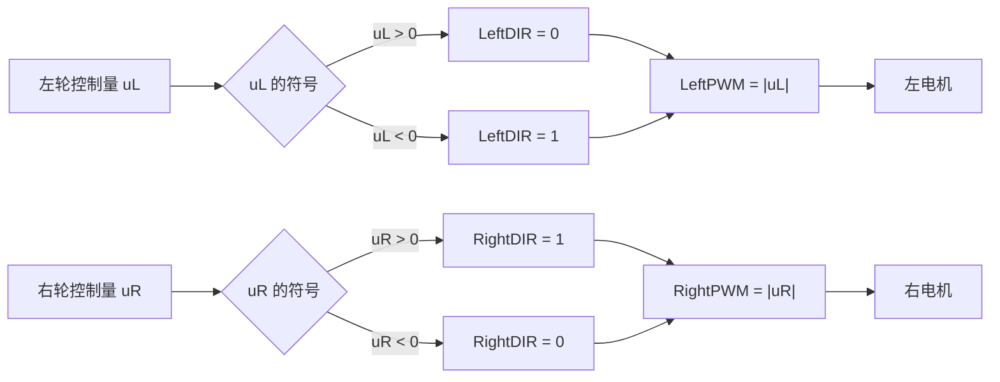
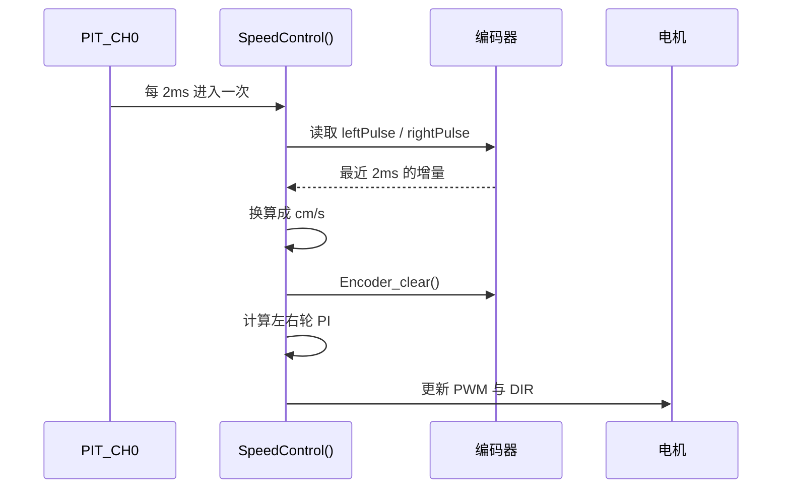
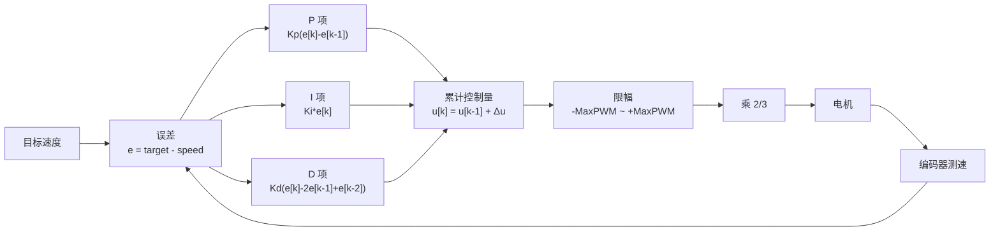
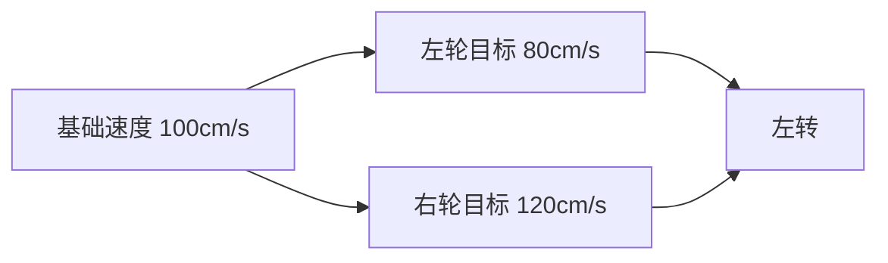
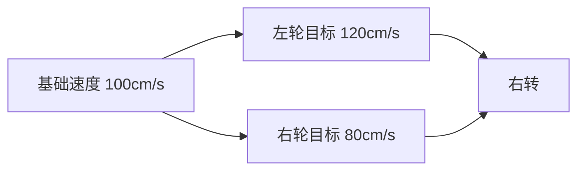

# SpeedControl.c 代码详解：电机调速与左右轮差速

本文分析当前工作树中的 `project/code/SpeedControl.c`，说明电机 PWM、编码器测速、增量式 PI 和左右轮差速的实现方式。文中行号以当前文件为准。

核心文件：

- `project/code/SpeedControl.c`
- `project/code/SpeedControl.h`
- 调用位置：`project/user/src/main.c`
- 定时中断：`project/user/src/isr.c`

文中的 Mermaid 图需要 Markdown 查看器支持 Mermaid。GitHub、部分 Markdown 插件和在线渲染器可以直接显示。

## 1. 结论先行

`SpeedControl.c` 的控制链是：

```text
摄像头方向误差
  -> 更新左右轮目标速度
  -> 2ms 读取一次编码器
  -> 左右轮分别计算速度误差
  -> 增量式 PI 累加 PWM 控制量
  -> 限幅并乘 2/3
  -> DIR 控制方向，PWM 控制转速
```

当前代码的实际状态：

- 速度环运行周期为 2ms，即 500Hz。
- 速度单位是 cm/s，`expSpeed=100` 约等于 1m/s。
- 当前 `LKliff=0`、`RKliff=0`，左右轮目标速度相同，没有实际差速。
- 最终 PWM 最大只有 6666，对应 66.66% 占空比。
- 当前 `speedD=0`，速度环实际是 PI。

## 2. 文件与硬件资源

### 2.1 引脚定义

| 功能 | 宏 | 硬件资源 |
|---|---|---|
| 左电机 PWM | `LeftPWM` | `PWM1_MODULE3_CHA_D0` |
| 左电机方向 | `LeftDIR` | `D1` |
| 右电机 PWM | `RightPWM` | `PWM2_MODULE3_CHB_D3` |
| 右电机方向 | `RightDIR` | `D2` |
| 左编码器 | `QTIMER1_ENCODER1` | C0/C1 |
| 右编码器 | `QTIMER1_ENCODER2` | C2/C24 |

### 2.2 关键参数

| 参数 | 当前值 | 作用 |
|---|---:|---|
| `MOTOR_FREQUENCE` | 17000 | 电机 PWM 频率，17kHz |
| `dt` | 0.002 | 速度环周期，2ms |
| `LEFT_PULSE_PER_METER` | 12000 | 左轮每米脉冲数 |
| `RIGHT_PULSE_PER_METER` | 12000 | 右轮每米脉冲数 |
| `expSpeed` | 100 | 基础目标速度，约 1m/s |
| `speedP` | 2700 | 缩放后实际 P=27.0 |
| `speedI` | 520 | 缩放后实际 I=5.2 |
| `speedD` | 0 | 当前未启用 D 项 |
| `MaxPWM` | 10000 | 内部控制量限幅 |
| 最终 PWM 上限 | 6666 | `10000 * 2 / 3` |

## 3. 整体控制链

主循环负责处理摄像头图像并更新目标速度，2ms 中断负责读取编码器和输出 PWM。两者是异步关系。


对应调用关系：

- `main.c` 配置 `pit_ms_init(PIT_CH0, 2)`。
- `isr.c` 的 `PIT_IRQHandler()` 每 2ms 调用一次 `SpeedControl()`。
- `main.c` 每处理一帧图像，调用 `Speed_Correct()` 更新目标速度。

## 4. 电机 PWM 与方向控制

### 4.1 初始化

`Motor_PWM_Init()` 位于 `SpeedControl.c` 15~21 行：

```c
void Motor_PWM_Init(void)
{
    pwm_init(LeftPWM, MOTOR_FREQUENCE, 0);
    pwm_init(RightPWM, MOTOR_FREQUENCE, 0);
    gpio_init(LeftDIR, GPO, 0, GPO_PUSH_PULL);
    gpio_init(RightDIR, GPO, 0, GPO_PUSH_PULL);
}
```

初始化后两路 PWM 占空比都是 0，电机不会转动。

驱动采用“一路 PWM + 一路方向 GPIO”的方式：



### 4.2 正反转真值表

| 控制量符号 | 左电机输出 | 右电机输出 | 标定后的运动 |
|---|---|---|---|
| 正数 | `LeftDIR=0`，PWM=数值 | `RightDIR=1`，PWM=数值 | 前进 |
| 负数 | `LeftDIR=1`，PWM=绝对值 | `RightDIR=0`，PWM=绝对值 | 后退 |
| 0 | PWM=0 | PWM=0 | 停止 |

左、右方向脚的正逻辑相反，是因为两个电机在车上的安装方向相反。这里的“正数”表示程序标定后的前进方向。

`Set_Motor_duty()` 直接对负控制量取反，再写入 PWM：

```c
if(leftduty > 0)
{
    gpio_set_level(LeftDIR, 0);
    pwm_set_duty(LeftPWM, leftduty);
}
else
{
    gpio_set_level(LeftDIR, 1);
    pwm_set_duty(LeftPWM, -leftduty);
}
```

### 4.3 PWM 范围和有效上限

逐飞 PWM 库定义：

```c
#define PWM_DUTY_MAX 10000
```

因此：

- `10000` 表示 100% 占空比。
- `5000` 表示 50% 占空比。
- `0` 表示关闭输出。

速度环内部将累计控制量限制在 ±10000，但输出前又乘了 `2.0 / 3.0`：

```c
float Duty_left  = speedDuty_left  * 2.0 / 3.0;
float Duty_right = speedDuty_right * 2.0 / 3.0;
```

所以实际最大 PWM 是：

```text
10000 * 2 / 3 = 6666
```

即有效最大占空比为 66.66%。代码没有说明 `2/3` 的原因，通常是为了限制电机电流、电压或最高转速。调高该系数前需要确认驱动板和电机能承受。

## 5. 编码器测速

### 5.1 读取与清零

`Encoder_getvalue()` 位于 `SpeedControl.c` 62~66 行：

```c
leftPulse  = -encoder_get_count(QTIMER1_ENCODER1);
rightPulse = encoder_get_count(QTIMER1_ENCODER2);
```

左编码器取负号，是为了让左右轮前进时都返回正数。右编码器不取反，说明两个编码器的安装方向相反。

`GetSpeed()` 随后换算速度并清零计数器：

```c
leftSpeed  = (leftPulse * 100) / (LEFT_PULSE_PER_METER * dt);
rightSpeed = (rightPulse * 100) / (RIGHT_PULSE_PER_METER * dt);
Encoder_clear();
```

每次读取的都是最近 2ms 内的脉冲增量，不是累计脉冲。



### 5.2 单位换算

以左轮为例：

```text
脉冲数 / dt                  = 每秒脉冲数
每秒脉冲数 / 每米脉冲数      = 米/秒
米/秒 * 100                  = 厘米/秒
```

所以：

```text
leftSpeed 单位 = cm/s
rightSpeed 单位 = cm/s
```

当前每米脉冲数和周期为：

```text
12000 pulses/m
dt = 0.002s
```

每 2ms 收到 24 个脉冲时：

```text
24 / 0.002 / 12000 = 1m/s
```

因此以下目标速度约等于：

| `expSpeed` | 目标速度 |
|---:|---:|
| 100 | 1.0m/s |
| 150 | 1.5m/s |
| 200 | 2.0m/s |

左右轮编码器如果实际每米脉冲数不同，应分别标定 `LEFT_PULSE_PER_METER` 和 `RIGHT_PULSE_PER_METER`，否则两轮目标相同时实际车速仍可能不一致。

## 6. 左右轮目标速度

`Speed_Correct()` 位于 `SpeedControl.c` 76~85 行：

```c
expSpeedL = expSpeed + LKliff;
expSpeedR = expSpeed + RKliff;

if(StopFlag)
{
    expSpeedL = 0;
    expSpeedR = 0;
}
```

含义：

```text
左轮目标速度 = 基础速度 + 左轮差速偏置
右轮目标速度 = 基础速度 + 右轮差速偏置
```

当前值：

```c
int expSpeed = 100;
int RKliff  = 0;
int LKliff  = 0;
```

工程中没有其他位置给 `LKliff`、`RKliff` 赋新值，所以当前：

```text
expSpeedL = 100
expSpeedR = 100
```

左右轮目标完全相同，差速控制尚未启用。

`Speed_Correct()` 在主循环中跟随摄像头帧更新，不在 2ms 中断中运行。速度 PI 会持续使用最近一次写入的 `expSpeedL`、`expSpeedR`。

## 7. 增量式 PI 控制

### 7.1 误差计算

左右轮分别计算目标速度与实际速度之差：

```c
leftspeedError  = expSpeedL - leftSpeed;
rightspeedError = expSpeedR - rightSpeed;
```

符号含义：

- 误差大于 0：实际速度低于目标，需要增加 PWM。
- 误差小于 0：实际速度高于目标，需要减小 PWM。
- 误差等于 0：保持当前累计控制量。



### 7.2 计算公式

代码采用增量式 PID：

```text
u[k] = u[k-1]
     + Kp * (e[k] - e[k-1])
     + Ki * e[k]
     + Kd * (e[k] - 2e[k-1] + e[k-2])
```

其中 `u` 是 `speedDuty_left` 或 `speedDuty_right`。

当前参数：

```c
int speedP = 2700;
int speedI = 520;
int speedD = 0;
```

代码对 P、I 做了除以 100 的缩放：

```c
double SPEED_CONTROL_P = speedP / 100.0;  // 27.0
double SPEED_CONTROL_I = speedI / 100.0;  // 5.2
```

实际使用：

```text
Kp = 27.0
Ki = 5.2
Kd = 0
```

当前是 PI 控制器。D 项为 0，因此微分项暂时没有参与控制。

由于速度环固定运行在 500Hz，代码没有在公式中再乘 `dt`。P、I、D 参数本身是按当前采样周期整定的离散参数。

### 7.3 单次调节示例

假设左轮目标速度为 100cm/s，实际速度为 0cm/s，上一拍误差也是 0：

```text
e = 100
P 项 = 27 * (100 - 0) = 2700
I 项 = 5.2 * 100 = 520
本次增量 = 3220
```

累计控制量变成 3220，经过 `2/3` 缩放后输出：

```text
3220 * 2 / 3 = 2146
```

即约 21.46% 占空比。

下一拍如果电机还没转，误差仍为 100：

- P 项为 0，因为误差没有继续增大。
- I 项继续增加 520。
- PWM 继续上升。

实际速度接近目标后，误差减小，P 项可能变成负值，从而抑制超调；I 项则维持稳态输出。

## 8. 限幅与最终输出

左右控制量分别限幅：

```c
if(speedDuty_left > MaxPWM)
{
    speedDuty_left = MaxPWM;
}
else if(speedDuty_left < -MaxPWM)
{
    speedDuty_left = -MaxPWM;
}
```

右轮逻辑相同。

限幅直接写回累计控制量，因此也起到防止积分继续增大的作用。

完整输出链：

```text
目标速度
  -> 速度误差
  -> P/I/D 增量
  -> 累加控制量
  -> ±10000 限幅
  -> 乘 2/3
  -> ±6666 PWM
  -> DIR + PWM 驱动
```

`Set_Motor_duty()` 的参数是整数，因此浮点控制量在最后转换成 `int32` 时会截断小数部分。相对于 0~6666 的 PWM 范围，这个精度足够。

## 9. 左右轮差速原理

差速通过修改左右轮目标速度实现：

```text
左轮目标 = 基础速度 + LKliff
右轮目标 = 基础速度 + RKliff
```

### 9.1 左转

左轮是内侧轮，右轮是外侧轮：

```text
左轮慢，右轮快
```

例如：

```c
LKliff = -20;
RKliff =  20;
```

基础速度为 100 时：

```text
左轮目标 = 80cm/s
右轮目标 = 120cm/s
```



### 9.2 右转

```text
左轮快，右轮慢
```

例如：

```c
LKliff =  20;
RKliff = -20;
```

基础速度为 100 时：

```text
左轮目标 = 120cm/s
右轮目标 = 80cm/s
```



### 9.3 对称差速与平均速度

如果使用对称差速：

```text
LKliff = -Δ
RKliff = +Δ
```

平均目标速度为：

```text
平均速度 = (左目标 + 右目标) / 2
         = 基础速度 + (LKliff + RKliff) / 2
         = 基础速度
```

左右轮速度差为：

```text
速度差 = 右轮目标 - 左轮目标 = 2Δ
```

因此对称差速主要改变车辆转向趋势，不会明显改变整车平均速度。速度差越大，转向越强。

## 10. 结合 directionError 接入差速

当前 `Servo.c` 中：

```c
weightedError = MidLine[row] - COL / 2;
directionError = -3.0f * weightedError / COL;
```

方向误差符号：

| 图像中的赛道中心 | `weightedError` | `directionError` | 车辆动作 |
|---|---:|---:|---|
| 偏右 | 正 | 负 | 应右转 |
| 偏左 | 负 | 正 | 应左转 |

右转需要左轮快、右轮慢。因为赛道偏右时 `directionError` 为负，可以这样生成差速：

```c
int diff = (int)(DIFF_GAIN * directionError);
LKliff = -diff;
RKliff =  diff;
```

代入验证：

- 赛道偏右：`directionError < 0`，所以 `diff < 0`，`LKliff > 0`、`RKliff < 0`，车辆右转。
- 赛道偏左：`directionError > 0`，所以 `diff > 0`，`LKliff < 0`、`RKliff > 0`，车辆左转。

### 10.1 可用的接入示例

下面是接入示例，当前尚未写入源码：

```c
#define DIFF_GAIN          20
#define DIFF_MAX           30
#define MIN_FORWARD_SPEED  20

void Speed_Correct(void)
{
    int diff;
    int leftTarget;
    int rightTarget;

    diff = (int)(DIFF_GAIN * directionError);
    diff = LimitBoth_int(diff, -DIFF_MAX, DIFF_MAX);

    leftTarget  = expSpeed - diff;
    rightTarget = expSpeed + diff;

    if(leftTarget < MIN_FORWARD_SPEED)
        leftTarget = MIN_FORWARD_SPEED;

    if(rightTarget < MIN_FORWARD_SPEED)
        rightTarget = MIN_FORWARD_SPEED;

    expSpeedL = leftTarget;
    expSpeedR = rightTarget;

    if(StopFlag)
    {
        expSpeedL = 0;
        expSpeedR = 0;
    }
}
```

参数含义：

- `DIFF_GAIN=20`：方向误差为 1.0 时，差速量尝试达到 20cm/s。
- `DIFF_MAX=30`：差速量最多为 30cm/s。
- `MIN_FORWARD_SPEED=20`：防止内侧轮目标速度降到 0 或负值。

如果基础速度为 100cm/s，最大差速为 30cm/s，左右目标速度为 70~130cm/s。

### 10.2 调参建议

1. 先把 `expSpeed` 降到 20~30cm/s，在低速下测试差速。
2. `DIFF_GAIN` 从 5 开始，逐渐增加到 10、20。
3. 观察车辆是否出现甩尾、左右摆动或内侧轮反转。
4. 差速方向必须与舵机方向一致，否则车辆会一边转向一边被车轮拉回。
5. 如果图像误差跳动明显，可以降低增益或对 `diff` 做低通滤波。
6. 不要只加大差速来弥补舵机中位或机械问题。

## 11. 调试步骤

### 11.1 电机与编码器方向

首次测试应把车架空，给一个较小的目标速度，例如 20cm/s，然后检查：

1. 左右轮是否都向前转。
2. `leftSpeed` 和 `rightSpeed` 是否为正。
3. 提高目标速度时，两轮是否加速。
4. 目标速度设为 0 时，两轮是否减速并停止。

如果目标速度为正但车轮反转，或者速度误差越来越大、PWM 很快到限幅，优先检查：

- 电机方向脚逻辑。
- 编码器 A/B 相顺序。
- `Encoder_getvalue()` 中左编码器的负号。
- `LEFT_PULSE_PER_METER` 和 `RIGHT_PULSE_PER_METER`。

### 11.2 速度环

| 现象 | 常见原因 | 调整方向 |
|---|---|---|
| 加速很慢 | P、I 偏小 | 先增加 P，再增加 I |
| 速度持续振荡 | P 过大或 I 过大 | 减小 P，随后减小 I |
| 稳态速度偏低 | I 偏小或机械阻力大 | 适当增加 I |
| 超调明显 | P 过大 | 减小 P |
| 两轮速度不一致 | 编码器标定或机械阻力不同 | 分别标定脉冲数，检查轮胎和传动 |
| 输出一直饱和 | 目标过高或方向接反 | 降低目标，检查反馈符号 |

### 11.3 差速

| 现象 | 检查项 |
|---|---|
| 转向不足 | 适当增加差速，但先确认舵机方向正确 |
| 甩尾或过度转向 | 减小 `DIFF_GAIN` 和 `DIFF_MAX` |
| 内侧轮反转 | 提高 `MIN_FORWARD_SPEED` 或减小差速 |
| 直道左右摆 | 差速增益过大，或 `directionError` 抖动 |
| 差速方向相反 | 检查 `LKliff`、`RKliff` 的符号 |

## 12. 已知问题

### 12.1 D 项没有使用缩放变量

代码计算了：

```c
double SPEED_CONTROL_D = speedD / 100.0;
```

但公式实际使用的是原始 `speedD`：

```c
speedD * (leftspeedError - 2 * leftspeedError_last + leftspeedError_pre)
```

当前 `speedD=0`，没有影响。以后启用 D 项时，应改为使用 `SPEED_CONTROL_D`，否则实际 D 增益会比预期大 100 倍。

### 12.2 P、I、D 注释标注错误

```c
double SPEED_CONTROL_D = speedD / 100.0;     // 注释写成“限制作用P”
double SPEED_CONTROL_I = speedI / 100.0;     // 注释写成“速度控制参数D”
```

这是注释错误，不影响编译和运行，但会误导调参。

### 12.3 当前没有差速

`LKliff` 和 `RKliff` 只被初始化，没有在摄像头处理或方向控制中赋值。当前左右轮目标速度相同。

### 12.4 StopFlag 不会自动复位

`FindEndrow.c` 中：

```c
if(EndRow > 95)
    StopFlag = 1;
```

工程中没有把 `StopFlag` 清零的逻辑。一旦触发，车辆会一直保持目标速度为 0，直到复位或重新烧录。

另外，`StopFlag` 只把目标速度设为 0，电机输出仍由 PI 逐步收敛，不是立即切断 PWM。如果需要立即停车，可在 `SpeedControl()` 开头增加：

```c
if(StopFlag)
{
    Set_Motor_duty(0, 0);
    return;
}
```

## 13. 关键代码位置

| 功能 | 位置 |
|---|---|
| PWM 与方向初始化 | `SpeedControl.c` 15~21 行 |
| 设置电机占空比 | `SpeedControl.c` 23~45 行 |
| 编码器初始化 | `SpeedControl.c` 50~54 行 |
| 编码器读取 | `SpeedControl.c` 62~66 行 |
| 速度换算 | `SpeedControl.c` 68~74 行 |
| 目标速度与差速 | `SpeedControl.c` 76~85 行 |
| 增量式 PI 与输出 | `SpeedControl.c` 88~128 行 |
| 2ms 速度中断 | `isr.c` 13~19 行 |
| 主循环调用 | `main.c` 84~110 行 |

## 14. 快速检查清单

- [ ] 左右电机正方向正确。
- [ ] 左右编码器前进时速度为正。
- [ ] 每米脉冲数已实测标定。
- [ ] `expSpeed=100` 时实际速度约为 1m/s。
- [ ] 速度环不会持续饱和或振荡。
- [ ] 左右轮目标速度能够独立跟踪。
- [ ] `LKliff`、`RKliff` 的符号符合转向方向。
- [ ] 差速时内侧轮不会降为 0 或反转。
- [ ] `StopFlag` 触发后车辆能安全停止。
- [ ] 启用 D 项前已修正缩放变量。